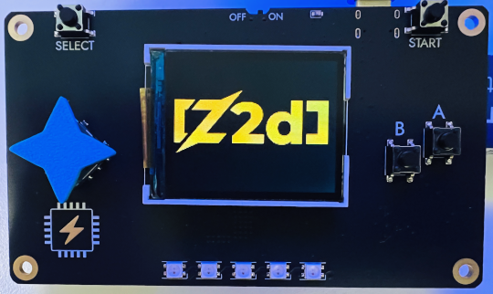

# z2d Demo for the SYCL v2 Badge

  

This is a standalone repository for a realtime rendering demo for the graphics
library [z2d](https://github.com/vancluever/z2d) running on the electronic
badge given to attendees of the tables day during the [Software You Can Love
Vancouver](https://softwareyoucanlove.ca/) 2026 conference.

This demo served (and will continue to serve!) as an opportunity to optimize
z2d for lower-end (particularly embedded) targets. It has already yielded a
number of updates to z2d, which are utilized here:

* Text shaping
* Path serialization
* Configurable float precision
* RGB565 pixel types
* Options to disable vectorized code (avoids `@Vector` unrolling!)

Note that some of these features are utilized *indirectly* by this project, to
help keep the size of the cart image down. Namely, we use a companion tool,
[vectorgen](https://github.com/vancluever/vectorgen), to generate serialization
assets for the text crawl demo.

## Building and using

If you're not familiar with how the badge works, you should probably check out
the upstream [sycl-badge](https://github.com/ZigEmbeddedGroup/sycl-badge)
repository, and [read the
manual](https://zigembeddedgroup.github.io/sycl-badge/).

Note that at this point in time, it's required to have the badge to run this
demo. This is due to the simulator not working with some of the MicroZig
features utilized directly by this demo (specifically the allocator).

If you have the badge, you can easily download the source off of this
repository, run `zig build`, and upload the image to the cart. The cart will be
located in the `zig-out/carts` directory, similar to the carts natively hosted
in the upstream badge repository.

## License

This project is licensed MPL 2.0. See LICENSE for a copy of the MPL.
